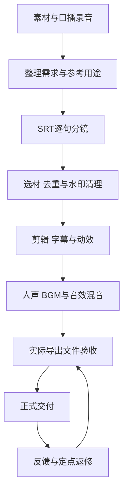

# 奕起聊车视频制作流程

这套流程用于把汽车素材和口播录音制作成完整视频，覆盖前期规划、素材整理、剪辑、字幕动效、声音后期、返修和交付。成片质量优先，工作量增加时留足制作与检查时间。

完整制作规范见 [AGENTS.md](../AGENTS.md)，执行时使用[返修与验收清单](CHECKLIST.md)。后续可复用技能的拆分见[技能建设计划](SKILL-ROADMAP.md)。

## 已落地的 Skill

本流程现已封装为 [yiqi-auto-video](skills/yiqi-auto-video/SKILL.md)，包括制作/定点返修说明、用户偏好、声音与封面规范，以及实际场景切点结合工程边界的短镜头检查脚本。

使用示例：`用 $yiqi-auto-video 按上次流程制作这条汽车视频，使用我给的素材和口播。`

[2026-11-14 制作复盘](skills/yiqi-auto-video/references/retrospective-2026-11-14.md) 说明 M4 第四版漏检的原因、第五版修复证据以及进度沟通需要改进的地方。检查脚本会输出候选和复核图，不能代替实际画面与声音验收。

## 开始制作需要提供什么

直接提供素材和口播录音即可；已有文案、SRT、参考视频或指定音乐时一起提供。标出必须使用的素材和最在意的效果，便于选材与剪辑。

画面比例、平台、时长或风格有特别要求时补充说明。优先沿用当前项目已经确认的设置，未指定的设置按项目规则执行。新任务只追问确实影响制作且无法从现有材料判断的信息。

## 前期规划与参考拆解

先整理已确认的目标、必须保留的内容、待判断的信息和本轮修改项。原口播是叙事基础，修改或补写台词按用户指令执行。

为每条参考记录用途：开场话术、画面构图、剪辑节奏、字体、动效或音乐。实际查看参考内容，明确借鉴的部分；多条参考分别记录，避免把软件界面动效参考与汽车开场模板混用。

需要比较风格时，在对话中展示样板供选择。样板默认只预览，不主动另存桌面、复制到工程或打包交付。正式采用并要求制作或保存的成片、封面及制作所需资产，再按指定位置保存。

## SRT逐句分镜

根据口播和停顿生成或校对SRT，再按语义安排镜头。每段分镜记录时间范围、对应台词、素材与原片入出点、字幕重点、动效和声音落点。

镜头围绕当前台词表达一个主要重点。车型参数段核对代际、年款、原厂或改装版本；氛围镜头与性能数据对应镜头分别判断适用性。

图片展示时长作为单片配置。RS7这次采用每张约1.5秒、最长不超过2.5秒，并以视频隔开；制作其他视频时根据当次指令设置，避免把这条片的所有镜头长度写死。

## 素材整理与水印清理

从用户提供的文件、Eagle素材库和必要的补充来源中选材。先看清晰度、光线、构图、运动质量和台词适配程度；有水印的优质素材可以选用，随后处理水印。

每项素材保留以下信息：

- 文件或来源链接、作者和许可证。
- 实际分辨率、源帧率、可用时长与原片入出点。
- 车型代际、原厂或改装版本，以及可辨认的车辆身份。
- 已使用的时间区间、水印位置和处理状态。

画面源素材按原生4K及以上要求核对。裁切或放大后重新检查实际像素，不把放大文件标为原生4K。指定素材未达标时先寻找替代，并如实说明未达标项。

检查原片内部切点，剔除只有几帧的上一镜残留、闪屏和不需要的转场。对需要避免重复的项目，检查原片时间区间是否重复，以及同一车辆是否反复返回；连续展示同一车辆的多个角度按当前叙事和用户要求安排。

可以取得同一素材的干净原文件时直接使用；需要后期清理水印时，检查汽车细节、构图和运动连续性，复核修补区域有无闪烁、拖影或模糊块。素材来源、许可证及必要署名继续记录。

## 剪辑字幕与动效

时间轴、制作预览和修改导出统一使用60fps。素材分辨率与成片分辨率分别设置，横竖版分别排版，按当前画布计算安全区。

字幕按语义拆分，保持口播同步。普通字幕和重点词建立统一层级；强调词、关键数字、颜色、字号及出现时间作为可配置项。字体先核对中文和数字字形，保证手机尺寸预览可读。

动效按照表达目的选择预备动作、缓入缓出、跟随、夸张和停留等安排，应用动画十二法则。真实汽车保持比例，文字进入阅读阶段后稳定；硬切与适量转场结合，检查切镜前后帧和最大过冲帧。

## 人声配乐与音效

分别保留人声、BGM和音效分轨。根据实际录音处理空旷感、噪声与动态，保护原有台词和语速。

BGM和音效使用现成录音或用户指定素材，不使用音乐或音效生成器。音效先确定对应动作或话语及落点，再选择音色、时长和强弱；可使用仓库中的 [sound音效工具](../README.md) 搜索与下载，逐条保留来源和许可信息。

人声优先，音乐和音效按需要避让。检查淡入淡出、尾音、整体响度、峰值和段落之间的音量变化。技术分析与实际试听分别记录，未实际试听或手机播放时，不将其写成已完成。

使用指定音乐时核对具体版本及截取位置。插入纯音乐展示段时，把配音、字幕和其他声音一起重新对齐；保留参考音频中的既有效果时注明其来源。声音设计中的引擎录音与车辆现场同期声分别准确标注。

## 定点返修

每轮修改记录基准版本、反馈时间点、需要改变的内容、影响范围和验收结果。保留旧版，完成修改后检查相关前后镜头。

插入或删除内容时统一更新视频、字幕、配音、音乐、音效和片尾时间。例如插入10秒展示段后，原来72秒附近的镜头会移动到约82秒；返修记录同时保留旧时间和新时间。

有卡顿或闪屏时同时检查原素材、截取边界、源文件定位、时间轴与导出结果。60fps文件仍可能包含源素材中的错误切点，帧率检查与实际画面检查都要完成。

## 成片验收与正式交付

对实际导出文件检查完整解码、帧率、画面尺寸、时长和音画同步，再查看重点镜头、字幕安全区、水印清理区域、切点和片尾。自动检测发现的静止或高变化片段需要结合内容复核，区分正常静止画面、自然光线变化和真正的异常。

正式交付前修复已发现的问题，未解决的质量问题如实说明。需要更多制作或检查时间时及时告知，不因工作量增加而省略步骤。

按用户指定位置保存正式视频及所需SRT、封面，保留版本信息，核对文件实际存在、复制内容一致并可打开。完成后提供可点击的成片或预览入口。公开发布、上传素材和保存本地成片分别按用户授权执行。

## 封面制作

根据选定风格制作独立封面，检查标题内容、字体、汽车细节和发布时的裁切。需要图片编辑时使用可用的图像编辑工具，保留指定主体与构图。

先查找已有原图，记录实际像素；整张样板中的单格不当作独立高清原图。正式封面保存最终文件和可追溯的源文件位置，低分辨率重做结果如实标注。封面样板继续遵守只预览的要求。

流程更新日期：2026-11-14。
